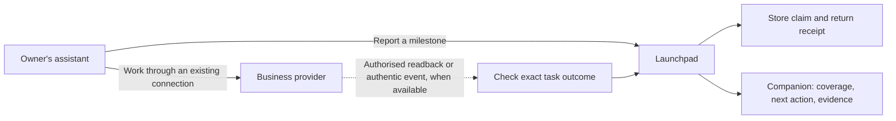

# Assistant progress reporting and a trustworthy companion

Design proposal, 27 October 2026. Not implemented or client-tested. Supporting research: three parallel investigations of MCP protocol, evidence/state and owner experience; parent inspected the load-bearing primary specification excerpts. No cross-provider review is claimed.

## Aim and limits

Help a small-business owner concentrate on their core work while every other responsibility is accounted for and, wherever possible, handled by their assistant. Aim for complete coverage; do not remove difficult or unsupported work to manufacture 100%. This is a general product, not a custom system for the pilot companies. Company-specific facts are data, never hardcoded branches or bespoke workflows.

A complete responsibility inventory, an operational arrangement and a completed business task are different things. We can design for all three. We cannot honestly promise universal autonomous execution: some responsibilities are unknown until assessed, some providers cannot be connected, and some decisions/signatures remain human. Owner-only work must stay visible even at full managed coverage.

The agent makes the final business assessment: what is relevant, where effort matters and whether the owner can concentrate on core work. Launchpad supplies a framework, context and trustworthy factual records; it does not replace that judgment with a questionnaire or a server-generated verdict. The agent may know the business well, but its context can still be incomplete or stale. Make assumptions and gaps visible instead of treating familiarity as certainty.

The main screen answers **“Is my admin handled?” and “Do you need me?”** The owner's assistant remains the working interface. Launchpad is the small companion for setup, status, decisions and evidence. It should not require the owner to understand MCP.

## Recommended experience

1. Identify the company from public data or assistant context; ask only when ambiguous. Public registry access does not prove ownership. Authorise private progress separately.
2. Give the assistant the assessment framework and authorised existing context. It maps responsibilities, classifies relevance and core work, and prioritises leverage points using what it already knows. Ask only for consequential missing facts; do not repeat onboarding questions or require the owner to ratify every judgment. Show unassessed and unsupported areas. Until the relevant responsibility domains have been assessed, show mapped counts and “Assessment incomplete”; suppress the overall percentage and completion celebration.
3. Explain progress sharing in one short permission: what the assistant sends, why, where it stays and how to stop it. Reporting is optional and separate from permission to take business actions.
4. Connect an existing service and complete one useful task. A successful authenticated call earns “Connected”; a supported task with appropriate evidence earns “First useful task completed.” Historical badges never hide a broken current connection.
5. Show a calm status, a count with scope, freshness and one concrete next action. Put the responsibility list, activity and data details one tap away. Surface overdue, failed or unknown work ahead of celebration.

Example: **“One thing needs you”**, then “5 of 8 responsibilities covered · 1 still needs assessment” and **“Reconnect bookkeeping.”** Detail explains why access expired, which work is affected and where the user is going. When evidence is stale, use “Status needs checking,” not “Everything handled.” When only reports exist, say “Reported by your assistant.”

No decorative score, connector wall, leaderboard, streak or invented hours saved. The main coverage view does not switch silently into a setup percentage or this month's task completion. Setup milestones and period outcomes live in clearly named detail views.

The next-action experience must satisfy [R-001: recommend the action that removes the most owner work](../requirements/R-001-next-best-action.md). This is an accepted requirement; the implementation choices below remain proposals.

## The agent’s assessment framework

Provide a compact checklist, not a second agent platform. The existing assistant uses its business context and Launchpad’s authorised records to answer:

1. **What matters here?** State the owner’s core work and relevant responsibilities across money, customers, people, legal/sector duties and operations. Classify each as applicable, not applicable or unresolved, with a short reason and evidence/context references. Include unsupported duties and dependencies; industry codes alone are insufficient.
2. **Who handles it, and how dependable is that?** Identify the actual executor, existing connection or delegation, recurrence/checkpoint, permissions and exception path. Distinguish a verified arrangement, an arrangement known only from assistant context and a proposed handoff.
3. **Where is the leverage?** Prefer a connection already in use; consolidate repeated work; use an existing accountant or other delegate; use actual provider automation for recurrence; route exceptions to the right person. Rank by likely reduction in owner interruptions, importance and practical feasibility. Estimates are estimates, not measured hours saved.
4. **What remains uncertain or needs the owner?** Name missing facts, stale context, conflicting evidence, unsupported actions and owner-only decisions. Ask only the question that unlocks the next useful step. “Needs assessment” is a useful result, not a failure to hide.
5. **What is your final assessment?** Give a short conclusion, its scope/date, assumptions, gaps and highest-value next action. The agent decides this assessment; the owner can challenge or correct it without having to approve every classification.

The assessment contract is a versioned, structured record: assessed domains; responsibility IDs and applicability/core classifications; concise reasons and evidence references; identified arrangements and their provenance; unresolved gaps; ranked leverage points; and a short final conclusion. Store a concise explanation, not hidden reasoning, full conversation excerpts or business documents. Reuse existing context in the assistant without copying it into Launchpad.

Agent classifications can update the assessment without owner ratification. Record the authenticated caller, reason and visible before/after difference whenever the inventory, core boundary or applicability changes. Never silently delete an unfinished responsibility: retain its prior classification and explain the new one. A conflicting sourced obligation or factual record stays visible as a discrepancy until resolved; an agent assessment does not overwrite it. Canonical task outcomes and historical success criteria remain separate from the evolving business assessment.

Label the conclusion **“Your assistant’s assessment”** and factual records by their evidence labels. The agent may judge that all assessed non-core work is covered, even recommend a conditional 100% assessment, but must state what this includes, its assumptions and any human involvement. Launchpad must not present that judgment as independent verification or global certainty, or convert it into the confirmed-coverage metric. Known unresolved gaps make a whole-company completion claim unsupported; the assistant should say so. The owner should see the useful conclusion first, with the basis and changes one tap away.

## Reporting through MCP

Use ordinary MCP tools. MCP tools support input schemas, structured results and explicit application handles; they do not prescribe a host interaction or guarantee the model will call the reporting tool. [Official tools specification](https://modelcontextprotocol.io/specification/2026-07-28/server/tools).

Built-in `notifications/progress` is optional server-to-client feedback about an active request. It stops when the request ends; it is not a durable assistant-to-Launchpad business journal. [Progress specification](https://modelcontextprotocol.io/specification/2026-07-28/basic/patterns/progress).

The optional Tasks extension supports asynchronous server execution when a client declares support. It does not create an autonomous assistant scheduler. Even a task marked `completed` may carry `isError: true`; protocol completion does not establish business success. Do not require this extension for the initial reporting flow. [Tasks specification](https://tasks.extensions.modelcontextprotocol.io/specification/2026-07-28/tasks).

Keep the existing planned `get_started`. Add three small application tools; extend the existing progress read with the framework instead of adding a separate context service:

| Tool | Contract |
|---|---|
| `get_progress(company_ref, task_id?)` | Return the compact assessment framework, authorised business facts and latest assessment, responsibilities, task/period IDs, versions, evidence, freshness, attention items and next step. Do not request or import the assistant’s whole conversation. Company is an authorised selector, not proof of access. |
| `report_assessment(company_ref, report_id, expected_version, assessed_at, assessment)` | Save the bounded assessment contract above, including classifications and short reasons. Return its visible revision/diff and receipt. This is agent judgment, not a source-confirmed outcome or action approval. |
| `report_progress(company_ref, task_id, report_id, expected_version, observed_at, milestone, evidence_ref?)` | Record a narrow assistant claim against an existing task. Return a durable receipt, evidence label, resulting version and next action. No percentage, approval, verified flag, transcript or arbitrary payload. |

Report at meaningful checkpoints: started, draft prepared, waiting for owner, blocked, external completion reported. Persist atomically before acknowledging. A receipt means **Launchpad saved the report**, not that it checked the external result. Return structured data plus a readable equivalent for compatible clients. SDK/protocol version support and actual assistant behavior must be tested; current specification existence is not proof of client adoption.

An assistant may succeed at a provider and close before reporting. We cannot eliminate this gap with a prompt. Display last report/check time and “No background monitoring” when appropriate. Dependable recurring work requires a named actual executor, tested trigger, valid permission, next run/checkpoint, failure detection and escalation. Prefer existing provider automation. If Launchpad later owns a recurring job, implement and test that runner explicitly; MCP alone is not the runner.

## Execution boundary for direct connectors and browsers

If an assistant controls a provider or generic browser directly, Launchpad cannot enforce approval before those external actions merely by accepting a later report. Only claim server-enforced approval for operations on a controlled execution route or a demonstrated downstream approval mechanism. Raw browser tool consent is not approval of an exact business transaction. Prefer existing supported service connectors; use browser access for supervised preparation with the project hard stops. Cloud login profiles, local browser storage and model data processing must be disclosed separately. See the [browser comparison](../research/K-browser-mcp-services.md).

## Evidence and business state

| Evidence label | Meaning |
|---|---|
| Assistant reported | An authorised caller made a claim; external outcome is unchecked. |
| Owner/accountant confirmed | An independently authenticated person confirmed this exact task. An assistant repeating their words is not this evidence. |
| Source confirmed | Server code checked an authorised provider object/event against company, object, period and the task's success criterion. |
| Launchpad produced | Launchpad generated the named draft/calculation; this establishes no external sending, acceptance or payment. |

The server owns factual evidence labels, permissions and arithmetic; the agent owns the business assessment and its relevance/priorities. An assessment can classify applicability or core work with reasons and a visible revision, but cannot mark a provider outcome verified, erase a sourced fact, split completed tasks to inflate factual completion, or rewrite a historical task’s success criterion. Changes to future task definitions are explicit and versioned. Show conflicts between judgments and sourced duties for resolution rather than silently overriding either. Copied tool results, screenshots, hashes and URLs remain claims until checked. Do not fetch arbitrary evidence URLs; resolve known provider/object references through allowed connections. Where no verification route exists, retain a report or offer explicit human confirmation instead of building an adapter solely to award a badge.

Keep workflow state separate from business outcome. A task can be blocked or awaiting owner while its document is a draft. Preserve submitted, accepted, rejected and paid where applicable; define provider-specific success predicates. Preparing a filing may complete a preparation task but never its submission task. Transport success does not imply acceptance or settlement. Source reversals can reopen an outcome with an explanation.

Reporting never authorises execution. Neither reporting tool nor an assistant's “owner approved” text may create an approval. Exact recipient, amount, period and document bindings remain in a separate server-enforced approval mechanism. Changes invalidate approval. Existing bans on automatic PIN entry, signatures, real government submissions and payments remain binding.

## Completeness and the denominator

Maintain a versioned responsibility inventory across administration, money, customers, people, legal/sector duties and operations. The existing 354-job research is a discovery starting point, not proof of universal completeness. Public registers cannot reveal every contract, promise, informal process or owner preference. Let the agent assess the map from existing context and show unassessed areas. Invite owner correction; do not require a duplicate questionnaire or approval of each judgment.

For one scope revision:

- `A`: responsibilities assessed as applicable and non-core, including unsupported ones; expose the agent’s classification and basis.
- `U`: unresolved applicability; these remain visible and in the denominator.
- `N`: assessed not applicable, with the agent’s reason, source/context basis and assessment date. Exclusion is visible in the revision history, not silently removed.
- `H`: applicable responsibilities with a current, confirmed operational arrangement, required access, success criterion, named executor and next checkpoint/failure path. An arrangement known only from assistant context remains labelled assistant-assessed; it can inform the final judgment but is not independently confirmed merely because the agent includes it.

**Confirmed managed coverage = H / (A + U)**. This is an evidence-bounded operational metric over the agent-assessed inventory, not the final business assessment. Display the count first, the fraction second, and expose the full inventory. Zero denominator means “Assessment not complete” or “No responsibilities identified,” never 100%. Any unassessed domain suppresses the overall percentage and 100% badge, even if all mapped items have arrangements. Show “5 of 8 mapped responsibilities covered; assessment incomplete.” Discovery gaps are not a finite count of all unknown duties. After the agent has assessed the relevant domains and disclosed remaining assumptions, the fraction may be displayed with its scope and assessment date; owner ratification is not required. The server checks arithmetic and evidence eligibility, not whether the agent’s view of the business is infallible.

Distinguish AI/provider automation, delegated human work and work the owner must start. A session-only assistant does not cover future unattended work. A promised handoff is not a confirmed arrangement. Human delegation may contribute to managed coverage but never to an AI autonomy claim. If the owner must initiate every cycle, it is not off their plate.

If the factual metric reaches 100%, label it **“All listed arrangements confirmed · assessed scope.”** Keep it distinct from the agent’s broader conclusion. An agent’s conditional 100% assessment is labelled **“Your assistant assesses all non-core work as covered”**, with scope, assumptions, evidence limits and date—not a verified-completeness badge. Show any owner decisions/signatures alongside it and disclose human involvement. This is an operational milestone toward the owner's ambition, not a redefinition of the ambition as achieved. Do not claim “everything else handled by AI” while human or unsupported gaps remain.

Period completion is a separate detail: required canonical task occurrences, including overdue carry-over, compared with completed success criteria. Assistant reports alone do not count as confirmed completion. Distinguish source-confirmed and human-confirmed outcomes. No due tasks means “Nothing due in this period,” not an achievement. Subtasks cannot inflate the score; cancelling or hiding work cannot earn credit. New responsibilities visibly change the scope revision and count.

## Transparency with progressive detail

At connection, say what Launchpad receives and what it does. Proposed plain-language permission: **“Let your assistant save task updates and its business assessment here. Launchpad receives task references, status, times, receipt references and short assessment conclusions and reasons so you can see what is handled and what needs you. It does not need your conversations or documents. This permission does not approve business actions.”** Show actual field examples, storage duration and controls before enabling; keep reporting off until granted. Do not promise a particular assistant's pre-call UI without testing it.

The activity list covers every Launchpad-visible call, including reads, reports, checks and failures. A compact row names purpose, time, authenticated client, destination and outcome. Detail shows:

- a concise safe summary, plus an expandable exact accepted task-report or assessment payload for the authenticated owner, what changed and what did not;
- evidence basis, source observation/check time and receipt;
- data destination and retained fields/expiry;
- readable error and the next step when something failed.

Do not imply Launchpad observes direct assistant-to-provider calls: display those as assistant reports. Derive client identity from authentication; model names supplied in text are self-declared. Publish clear tool descriptions, requested scopes and the implementation in the public repository. Public source is useful for inspection, but is not proof that a deployed service matches it; disclose deployment version when available.

Offer **Stop progress sharing**, **Disconnect**, **Export my progress**, and **Delete my progress** in connection details. Explain the distinctions: stopping reports does not stop a provider's scheduled jobs; disconnecting Launchpad does not revoke direct assistant/provider connections; deleting Launchpad progress does not delete the provider's ledger. Reporting-off must be server-enforced, not a suggestion to the assistant. Keep the main screen quiet; expose these controls where people manage the connection. Do not silently broaden an earlier task-status-only grant to include assessment text; explain and authorise that additional sharing once.

## Minimal persistence and reliability

One service and relational database are sufficient: responsibilities, task occurrences and compact report/activity receipts, plus identity/connection/approval records. No event bus, generic workflow designer or new agent platform is required.

This feature deliberately extends “store almost nothing”: assignments, concise assessments and progress cannot be reconstructed from public registers. Proposed narrow amendment: **store minimal private operational state; do not store source documents, conversations or reasoning traces.** Do not silently change the repository's settled principle; make this proposal explicit before implementation. Retention proposal: current state until owner deletion; compact activity/report history for 30 days. This is a product choice to validate, not a legal retention rule. Separately define any necessary action/approval record policy before production.

Use bounded status enums, opaque typed references and validated timestamps. Task milestone reports contain no free-text narrative or arbitrary URLs. Assessment reports additionally allow bounded short conclusions/reasons, assumptions and gaps, explicitly disclosed in the sharing permission; they must not include copied conversations, documents or personal narrative. Show these exact accepted fields to the owner. Length limits reduce accidental bulk copying but cannot prove a short text contains no sensitive information: minimise it in the framework and allow export/deletion rather than promise content-free reporting. Keep provider credentials and sensitive execution payloads out of the progress receipt; disclose those through the separate action approval flow where applicable. Reject unexpected fields and avoid raw body logging in proxies, diagnostics and analytics. Store task/company/period IDs, actor/grant, event ID, status, observation/receipt times, version and minimal evidence references. A minimal proof may cease to be reproducible upstream; show that limitation rather than retaining full documents secretly.

Authenticate every call. Tokens must be issued for Launchpad's audience and authorised resource; provider tokens are not Launchpad credentials. Enforce company membership and narrow `progress:read` / `progress:report` permissions (the report grant explicitly covers task updates and concise assessments) server-side. [MCP authorisation](https://modelcontextprotocol.io/specification/2026-07-28/basic/authorization).

Deduplicate by authorised company, reporting principal, report kind and report ID; the canonical payload includes its task or assessment reference. Identical retries return the same receipt; changed payload with the same ID is a conflict. Process dedup before stale-version rejection so a lost acknowledgement can be recovered. Compare server versions atomically; old/concurrent reports cannot overwrite newer evidence. Reject impossible timestamps; freshness uses source time and per-playbook policy, not just arrival time. Retrying a report must never repeat the business action.

Deletion/revocation must invalidate old reporting grants or epochs so queued reports cannot recreate deleted data. Disclose backup deletion timing before production. Historical completion remains dated when a connection expires, while current recurring coverage becomes stale if its needed access/checkpoint fails.

## Email and calendar assessment

Include the owner’s existing mailbox and calendar, including generic IMAP providers. Assess the intended job before choosing a route: reading/searching, drafting, sending, mailbox changes, availability, event changes and attendee notifications need separate capabilities and permissions. IMAP alone does not provide SMTP sending or calendar access. Prefer an existing suitable connector over building a mailbox adapter or requesting provider migration. Explain who holds credentials and processes message contents; Launchpad progress reports do not need the full mailbox. A local bridge or recurring monitor needs a real running host. [Provider research and qualification checks](../research/M-email-calendar-agent-services.md).

## Build and validation sequence

1. One synthetic company, general responsibility model and one assistant route. Implement minimal authentication, read/report tools and durable receipts; report-only scope initially.
2. One useful existing-provider read workflow with a concrete result verifier. Build mobile status, next action, responsibility detail and activity detail together.
3. Add assessment revisions/correction, reporting controls, deletion/export and failure states before inviting private pilots. Test company separation with two pilot organisations and an unrelated synthetic business. No company-name branches, pilot-specific connectors or hidden manual backfilling.
4. Test actual target assistant and phone setup: authentication, tool visibility, repeated reports, receipts, return-to-chat path and honest stale/offline states. Use a copyable prompt if a deep link cannot be validated.
5. Extend only with demonstrated reusable workflows. Use Meta models for measured setup guidance or safe friction classification; deterministic code owns factual rules, evidence labels, permissions and arithmetic; the assistant owns relevance, priorities and final business judgment.

Acceptance cases: forged completion/approval; cross-company task access; stale conversation after company switch; duplicate and conflicting report IDs; concurrent updates; lost acknowledgement; wrong period; unsupported responsibility; unknown applicability; no due work; expired/revoked access; assistant closes without reporting; source reversal; owner-only signature; deletion followed by queued report; exact retained-data export; direct-provider activity honestly labelled unobserved. Include unknown-domain percentage suppression, reasoned agent scope changes without mandatory owner ratification, visible exclusion diffs, conflicts with sourced facts, a conditional agent assessment of 100% versus the factual metric, and exact accepted-payload inspection. No private business documents in fixtures or public demos, and no real consequential actions during tests.

Usability gate: a small-business owner can connect, get one useful result, explain what remains undone, distinguish reported from confirmed, inspect what was shared and stop sharing without technical assistance. Measure observed task completion and interruptions; do not claim an exceptional UX from visual polish alone.
